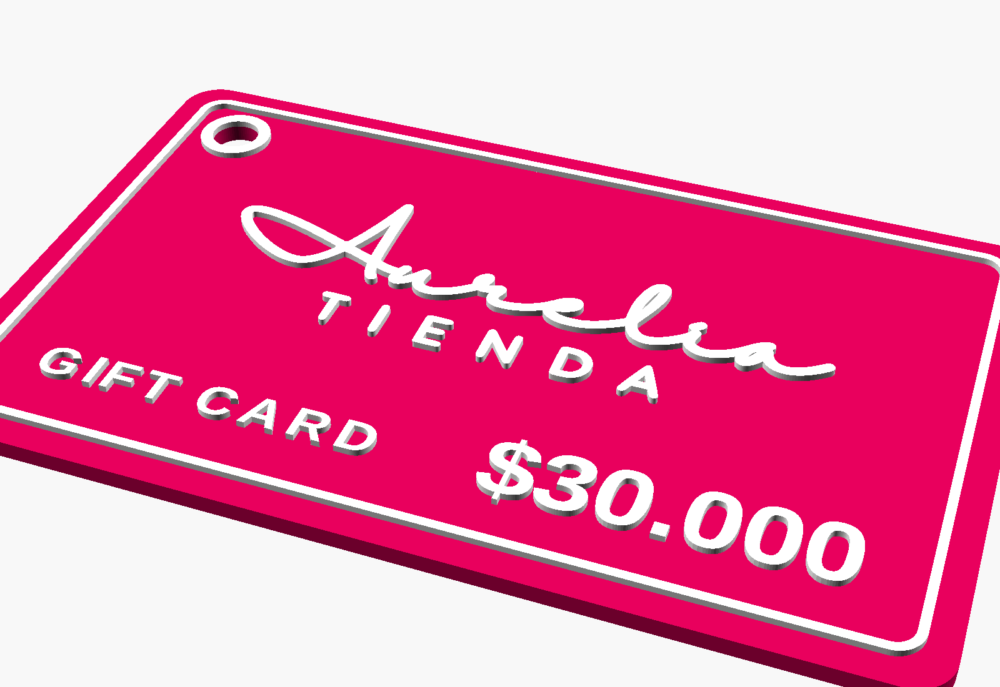
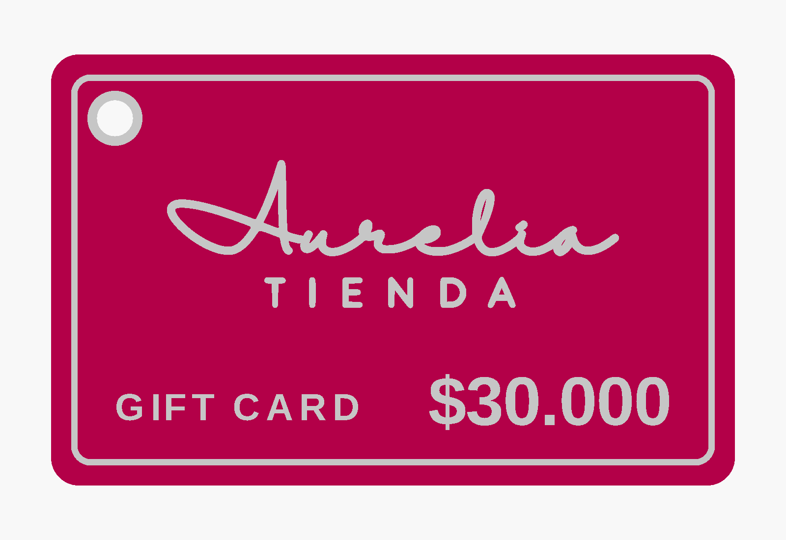
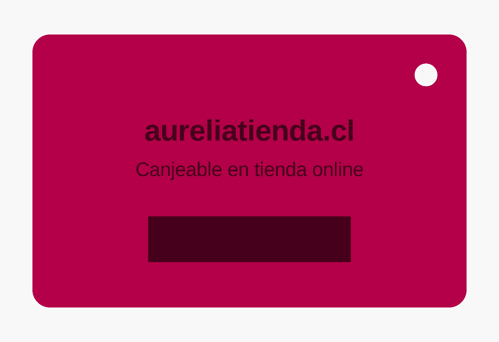

# Gift Card Aurelia · formato físico impreso en 3D

| Frente | Reverso |
|---|---|
|  |  |

## Ficha
- **Tamaño:** 85,6 × 54 mm (igual que una tarjeta de crédito) · 2,2 mm de grosor total.
- **Dos colores:** la base es fucsia Aurelia (0–1,6 mm) y el relieve, blanco o dorado (1,6–2,2 mm).
- **Frente:** el logo Aurelia Tienda vectorizado del original, la palabra GIFT CARD, el monto y un marco fino.
- **Agujero para cinta:** sirve para colgar la tarjeta del regalo.
- **Reverso grabado:** "aureliatienda.cl · Canjeable en tienda online" y un **bolsillo de 40 × 9 mm** para pegar el sticker con el **código único** de canje. El código no se imprime en 3D, así cada tarjeta es única y segura.

## Archivos
- `aurelia_giftcard.scad`: el diseño editable en OpenSCAD. Para un monto nuevo se cambia la variable `monto`.
- `logo_aurelia.svg`: el logo vectorizado.
- `stl/giftcard_base_fucsia.stl`: la base, igual para todos los montos.
- `stl/giftcard_{20000,30000,50000}_relieve_blanco.stl`: el relieve de cada monto.

## Cómo imprimir
**Impresora multicolor (Bambu A1 / A1 mini Combo con AMS Lite):**
1. Importa la base y el relieve del monto al mismo tiempo y responde "sí" cuando pregunte si es un solo objeto de varias partes.
2. Asigna el filamento fucsia a la base y el blanco (o PLA silk dorado) al relieve.

**Impresora de un color:** imprime con el fucsia y programa un **cambio de filamento (pausa) en la altura 1,6 mm**. Con capas de 0,2 mm es al comenzar la capa 9.

**Ajustes:**
- boquilla de 0,4 mm y capas de 0,2 mm
- cara del logo hacia arriba y sin soportes
- 3 paredes y 100% de relleno, para que la tarjeta quede rígida

**Rendimiento:**
- en la cama del A1 mini caben 4 tarjetas y en la del A1, 6 a 8
- cada tarjeta usa unos 9 g de PLA, o sea menos de $300 de material
